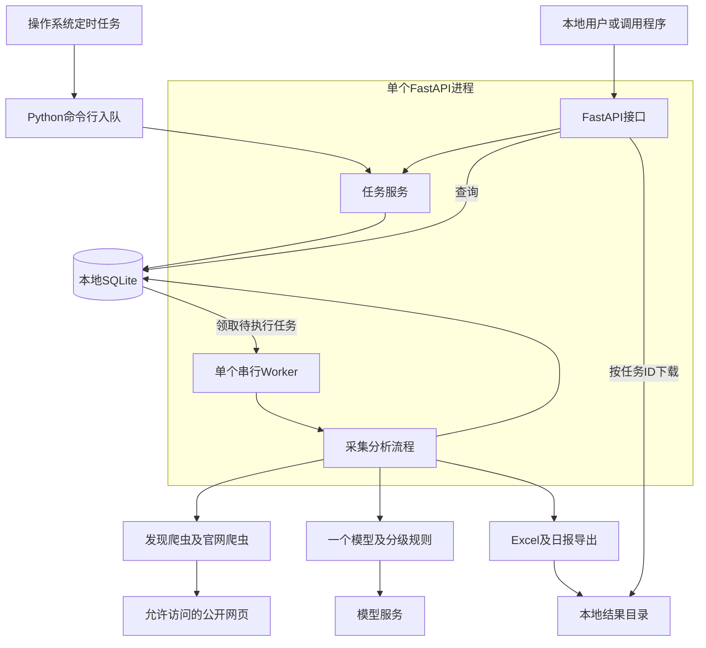

# 出海企业商机发现Agent MVP技术架构与设计

版本：1.0  
日期：2026年10月23日  
技术栈：Python、SQLite、FastAPI  
范围：MVP技术设计，尚未实现程序或部署任务

本方案承接《出海企业商机发现Agent MVP开发清单》，以单机方式完成“1至2类来源采集 → 数据存储与排重 → 商机分析 → Excel及日报输出”。本版将基础FastAPI接口纳入MVP，用于触发任务、查询线索和下载结果；MCP、对外开放接口、销售后台及CRM仍延后。

2026-10-24选型更新：Web发现采用DeepSeek Search，LLM指定deepseek-flash，暂不部署SearXNG；以[DeepSeek数据源与模型方案v1.1](出海企业商机发现Agent_MVP数据源与模型方案_DeepSeek_v1.1.md)覆盖下文固定目录发现及模型待选部分。新增search_cache及pages.metadata_json，Search调用与模型调用均须先预留费用；抖音仍为可选。旧SearXNG方案仅供历史参考，接口实际可用性尚待验证。

## 1 总体架构

采用一个FastAPI进程、一个串行Worker和一个本地SQLite数据库。定时任务只提交任务记录，Worker领取后执行。爬虫、分析和导出共用同一条业务流程。



边界约束：单机、单服务实例、单个执行中的业务任务。SQLite文件放本机磁盘；首版不引入Redis、Celery、微服务或分布式调度。

## 2 技术选型与模块

| 能力 | 选择 | 最小职责 |
| --- | --- | --- |
| 服务 | FastAPI、Uvicorn | 参数校验、入队、查询、文件下载 |
| 数据校验 | Pydantic | 配置、接口和模型输出结构校验 |
| 存储 | Python标准库sqlite3 | 参数化SQL、事务和数据持久化 |
| 采集 | HTTPX、BeautifulSoup | 请求HTML、解析列表和详情，限制超时及访问范围 |
| 分析 | DeepSeek deepseek-flash HTTP适配器 | 根据给定证据返回结构化事实和需求解释 |
| 导出 | openpyxl、Markdown文本 | 三张Excel工作表和一份简短日报 |
| 调度 | Windows任务计划程序或cron | 定时执行Python入队命令，不在Web进程内重复注册调度器 |
| 配置及日志 | TOML、环境变量、logging | 非敏感配置入文件，密钥入环境变量，日志关联run_id |

建议使用Python 3.11及以上，落地时固定具体Python及依赖版本，并记录内嵌SQLite版本。标准库sqlite3满足首版需求，不强制增加ORM。

```text
app/
  main.py                  # FastAPI入口及lifespan
  config.py                # TOML与环境变量校验
  cli.py                   # 初始化、入队、状态、备份
  api.py                   # 基础REST接口与认证
  db.py                    # 连接、事务、初始化及迁移
  repositories.py          # 企业、页面、任务、费用等SQL
  schemas.py               # 接口及模型输出结构
  worker.py                # 任务领取与串行执行
  pipeline.py              # 采集、分析、导出流程
  crawlers/
    base.py                # 统一采集结果与错误结构
    deepseek_search.py     # DeepSeek Search发现与查询缓存
    website.py             # 已核实企业官网的有限页面采集
  analysis/
    llm.py                 # 模型调用与结果缓存
    rules.py               # 产品适配、排除和A/B/C规则
  budget.py                # 调用前预留与费用核销
  exporter.py              # Excel、日报及发布清单
config/settings.toml
data/agent.db
data/reports/
data/backups/
logs/
tests/
```

以上为建议目录，不代表这些源码文件已经创建。

## 3 采集与商机处理流程

1. 读取并校验配置，将配置快照及版本写入任务，快照中剔除密钥。
2. DeepSeek Search按确定性模板发现候选；查询与正文分开缓存，再核实原页面；名单可作种子，不必另建目录专用爬虫。
3. 按公开主体标识排重，名称、城市和已核实官网作为辅助；同名或归属冲突保留待核实，不强制合并。
4. 保存页面必要摘录及企业关联；官网入口来自已核实公开链接或人工映射，最多抓取配置数量的首页、介绍、业务及联系页面。
5. 从公开商务语境中提取电话、邮箱、联系表单或企业账号，保存来源及归属状态。
6. 按业务证据及模型版本查缓存，需要时调用模型；Pydantic验证结构，再核对引用的页面、摘录和企业关联。
7. 由本地规则根据产品已知条件、需求证据、证据时效、联系方式和排除名单决定A/B/C及是否可跟进。
8. 固化本次导出快照，生成Excel、日报，发布成功后更新交付记录及任务状态。

发现源采用DeepSeek Search，原文及官网为补充证据来源。搜索API、原文HTML及允许访问范围仍需实际验证。首版不抓取PDF、图片、音视频、登录后内容，也不自动猜测官网或补全隐藏联系方式。

采集器统一返回企业候选、页面及公开联系入口、来源状态和错误原因。无结果、访问失败、受限和未配置分别记录。模型只接收必要业务证据；网页中的指令不改变工具操作或权限。

### 分析边界

模型返回出海事实、需求类型、明确表达或潜在场景、聚合支付关联、证据引用和待核实问题。每项业务主张包含page_id及原文短摘，无法核实的值为空。

规则负责最终准入：A需要实际出海、关键产品条件已适配、近期明确需求和归属明确的商务入口；B需要实际出海、至少可能适配、有证据的潜在场景及商务入口；其余为待研究C，明确不适配或排除主体不进入销售清单。产品关键条件全部未知时不能自动输出A或B。

模型缓存键包含enterprise_id、业务证据内容指纹、模型标识、提示词及输出结构版本。产品规则、联系渠道、排除名单或证据时效变化时重新执行本地规则；业务内容未变时可复用提取结果，不必重新调用模型。导出变化指纹忽略纯采集时间变化，避免每天把同一企业重复标成重要更新。

## 4 SQLite数据设计

原MVP的五组数据在实现中拆为八张表，额外关联用于表达“一篇名录包含多家企业”及固定导出快照；费用记录单独保存以保证预算可核对。

| 表 | 主要字段 | 约束及用途 |
| --- | --- | --- |
| enterprises | id、legal_name、identity_type、identity_value、city、region_status、website、excluded_reason、first_delivered_run_id、last_delivered_hash、created_at、updated_at | 可靠主体标识按地区和类型唯一；名称及电话不是全局唯一键 |
| pages | id、source_id、url、canonical_url、title、published_at、fetched_at、content_hash、excerpt、fetch_status | 同URL及内容指纹去重；发布时间可空，失败不覆盖最近有效证据 |
| enterprise_pages | enterprise_id、page_id、relation_type、attribution_status、evidence_json | 复合主键；支持一页多企业，保存主体及地区关联依据 |
| contacts | id、enterprise_id、type、value、normalized_value、attribution_status、evidence_json、last_checked_at | 按企业、类型及规范化值去重；evidence_json保存page_id和必要摘录 |
| analyses | id、enterprise_id、llm_input_hash、facts_json、assessment_json、evidence_refs_json、model_version、prompt_version、rule_version、product_version、created_at | 保存事实提取和最终规则结果；新评估引用可复用事实，历史结果不覆盖 |
| runs | id、idempotency_key、request_hash、trigger、scheduled_for、status、stage、config_json、stats_json、error_json、export_status、report_path、started_at、finished_at | 幂等键唯一；保存来源结果、配置版本及交付清单摘要 |
| run_items | run_id、enterprise_id、analysis_id、change_type、snapshot_json | 复合主键；冻结当次企业行、证据、联系方式及新增或变化分类 |
| cost_calls | id、run_id、provider、billing_month、status、reserved_micro_cny、actual_micro_cny、pricing_snapshot_json、created_at、updated_at | 一次外部付费尝试一条，区分预留、结算及费用未知 |

字段约定：ID由应用生成；时间内部保存UTC并在报告中转换到配置时区；JSON字段使用TEXT及应用结构校验。金额以整数微元保存，1元＝1,000,000微元，500元＝500,000,000微元，向上取整避免浮点及低估问题。未公开的标识、联系方式和发布时间保存NULL。

必须建立外键及索引：enterprise_pages两侧外键，contacts和analyses的企业外键，run_items的任务、企业和分析外键，cost_calls的任务外键；索引覆盖任务状态与创建时间、企业及分析时间、费用月份及状态、页面URL及内容指纹。JSON中的page_id由应用检查引用存在，SQLite不会为JSON数组自动维护外键。

数据库初始化启用WAL；每次建立连接启用foreign_keys并设置有限busy_timeout。WAL允许读写更好地共存，但同一数据库仍只有一个同时写入者，因此领取任务和记账使用短事务，不在事务中等待网络或模型。[SQLite WAL](https://sqlite.org/wal.html)、[SQLite PRAGMA](https://sqlite.org/pragma.html)

每个请求或Worker操作创建自己的短连接，用完关闭，不跨线程共享Connection。写入遇锁只有限重试；API无法完成时返回503，不能无限等待。数据库文件不放共享网络盘。

## 5 任务执行与定时设计

### 执行方式

FastAPI的lifespan负责启动及停止一个Worker循环。Worker从SQLite取QUEUED任务，以短事务将其改为RUNNING，串行完成一个任务后再取下一个。网络采集、同步SQLite及Excel处理放到受控执行线程，避免阻塞API事件循环。[FastAPI lifespan](https://fastapi.tiangolo.com/advanced/events/)

任务先持久化再返回202，不将请求后的BackgroundTasks作为唯一任务记录。该功能适用于响应后的进程内工作，本方案通过数据库保留任务状态及中断依据。[FastAPI Background Tasks](https://fastapi.tiangolo.com/tutorial/background-tasks/)

服务启动时先取得针对该数据库的操作系统排他文件锁，失败则退出；锁文件位于数据库旁，持有文件句柄，不能仅凭文件存在判断进程存活。生产仅允许一个Uvicorn worker且关闭reload。CLI只入队及查询，不另起业务执行Worker；备份恢复等维护命令在服务停止后执行。

### 状态及重跑

正常状态为QUEUED → RUNNING → SUCCEEDED；终态还包括PARTIAL、FAILED、BUDGET_STOPPED、INTERRUPTED。任务状态与export_status分开，来源部分失败也可生成真实的部分结果。

取得实例排他锁后，启动恢复逻辑将前实例遗留的RUNNING标为INTERRUPTED；保留页面、分析和费用记录。运营重新提交一个任务，利用排重及缓存完整重跑，MVP不做细粒度阶段续跑。正在运行但暂时无心跳的任务不能仅凭超时被另一个Worker重复执行。

Worker优雅退出时停止领取，等待当前步骤在配置超时内结束；强制终止后按中断恢复处理。模型调用失败或进程中断不代表没有发生费用，未知费用继续占用预留，不能直接释放后重试。

### 定时入口

操作系统定时执行入队命令，例如使用“任务配置ID＋计划时间”作为幂等键。任务即使在API暂未启动时也能写入SQLite，服务恢复后执行并在日报标明实际开始时间。

建议以Asia/Hong_Kong为业务时区，按周一至周五触发；时间待配置确认。任务完成后立即输出，不承诺采集时长未实测前固定09:00交付。漏掉的计划时点由入队命令按上次计划记录识别，最多补交一个合并任务并列明遗漏时段，防止休眠数日后堆积大量重复采集。

## 6 FastAPI最小接口

默认仅监听127.0.0.1；除健康检查外，接口要求环境变量配置的API Key。首版没有多用户权限和公网部署。请求不能传入任意采集URL、输出路径或临时提高预算，只使用已校验配置。

| 方法与路径 | 功能 | 关键约定 |
| --- | --- | --- |
| GET /healthz | 健康及数据库连通检查 | 不返回密钥、联系方式或本机文件详情 |
| POST /api/v1/runs | 提交按当前配置执行的完整任务 | 返回202及run_id；要求Idempotency-Key，重复相同提交返回原任务，键相同请求不一致返回409 |
| GET /api/v1/runs | 分页查询运行历史 | 默认20，最大100；可按状态过滤 |
| GET /api/v1/runs/{run_id} | 查询阶段、数量、来源、错误及导出状态 | 未知任务404；显示生成成功不等于外部发送成功 |
| GET /api/v1/leads | 查询当前A及B线索或待研究企业 | 支持城市、等级、需求、排除状态及分页；默认隐藏已排除主体 |
| GET /api/v1/leads/{enterprise_id} | 企业、最新分析、来源及联系方式详情 | 证据与未知项同时返回；未知企业404 |
| GET /api/v1/runs/{run_id}/artifacts/{kind} | 下载已发布xlsx或日报 | kind仅允许xlsx和daily；未发布返回409，文件缺失返回404 |
| GET /api/v1/budget | 查询当月已花费、未结算预留及余额 | 固定人民币口径，费用未知单列 |

创建任务示意：

```http
POST /api/v1/runs
X-API-Key: <从环境变量配置的密钥>
Idempotency-Key: manual-20261023-001
Content-Type: application/json

{}
```

```json
{
  "run_id": "run_example",
  "status": "QUEUED",
  "status_url": "/api/v1/runs/run_example"
}
```

以上为协议示例，不代表实际运行记录。请求幂等校验先查已存在记录，再决定是否创建；原任务始终使用原配置快照，不能因提交时配置变更而悄悄改写。CLI与API复用同一RunService及幂等规则。输入校验错误返回422，未授权返回401。

## 7 预算与输出一致性

### 500元月度预算

调用前使用BEGIN IMMEDIATE短事务汇总该自然月已结算费用与所有未结算预留，检查“当前占用＋本次最高预计费用≤500元”，通过后插入cost_calls并提交，然后才能请求模型。调用结束核销；明确未发生调用时可释放，账单未知时保留预留。每次重试是新的付费尝试，需单独预留及记录。

价格、输入上限、输出token上限及换算配置必须明确，无法给出保守费用上限时不启用该收费服务。月份按配置时区和请求发起时间归属，跨月在途不丢失预留；真实账单超预留时记录差异并停止新增收费调用。350元、450元预警，达到额度前停止新增收费请求，仍输出已完成结果。

### Excel及日报

输出三张表：可跟进商机、待研究、运行摘要。A及B为销售线索，C单列；所有行带enterprise_id、run_id及analysis_id，另有新增或重要变化标识。电话及账号以文本保存，外部文本不能写成公式。

先保存run_items快照，再在同一输出磁盘生成临时目录，目录内包含Excel、日报及manifest.json，manifest记录run_id、文件校验值和企业清单。校验成功后原子重命名为最终批次目录，最后以短事务更新export_status、首次交付及变化指纹。

若目录已发布但数据库未更新，启动恢复读取并校验manifest后补记交付，不重新计算首次新增。若文件生成或校验失败，保持未发布状态，下载接口不返回半成品。数据库记录与文件系统不声称具有跨介质原子事务，依靠该发布及恢复协议保持一致。

## 8 配置与本地运行

非敏感配置至少包括：数据库路径、输出和备份位置、城市及地址口径、已合作及拒绝名单、来源列表及白名单、抓取页数和超时、产品已知能力及禁入条件、证据窗口、模型和价格、月预算、业务时区、保存期限。

默认只启用一个发现来源，官网爬虫按需要开启；具体生产入口、允许访问范围、产品关键规则及保存期限未确认前，不启用持续采集。API Key、模型凭据由环境变量提供，不写入TOML、配置快照、日志或导出。

建议命令如下，仅为待实现的启动契约：

```text
python -m app.cli init-db
uvicorn app.main:app --host 127.0.0.1 --port 8000 --workers 1
python -m app.cli enqueue --schedule-key daily-20261023
python -m app.cli status
python -m app.cli backup
```

数据库结构用编号SQL迁移文件和PRAGMA user_version管理，迁移及恢复在服务停止后执行。备份使用sqlite3的backup能力生成一致性副本，不在WAL运行时仅复制agent.db主文件。[Python sqlite3 backup](https://docs.python.org/3/library/sqlite3.html#sqlite3.Connection.backup)

来源URL及重定向仅允许配置域名，并拒绝环回、私网、链路本地等地址；接口不接受任意URL。下载只按run_id和kind定位受控目录，不能传任意路径。日志仅记录必要ID、阶段、来源错误和费用，不记录密钥或完整个人联系方式。

## 9 开发顺序及验收

| 顺序 | 开发内容 | 验证重点 |
| --- | --- | --- |
| 1 | 来源验证、配置、SQLite及迁移 | 一个真实来源可读取并存储，企业与证据关联正确 |
| 2 | 发现及官网采集、排重、联系方式 | 重跑不重复建档，同名不误合并，商务入口有来源 |
| 3 | 模型适配、缓存、规则与预算 | 费用调用前受控，引用有效，未知不冒充A/B，规则变更可复用模型事实 |
| 4 | Excel日报及发布恢复 | 三表可读，数量一致，发布中断不重复计新增 |
| 5 | FastAPI、单Worker及CLI调度 | 入队返回202，任务串行、幂等，重启可识别中断，定时和手动共用逻辑 |

必要验证还包括：多个请求同时提交不重复领取任务；费用未知的失败不释放全部额度；一个来源失败仍生成部分结果；排除名单重跑仍生效；非白名单URL和越界下载被拒绝；备份能恢复并核对交付及费用。

建议用20家真实企业检查完整流程。至少有真实、证据成立且可联系的A或B结果，才算商机闭环通过；全为C时仅算技术链路跑通。每周100条以上和实际人工有效率通过后续试运行验证，不作为架构本身能保证的产量。

## 10 设计参考

本方案为MVP架构选择，以下文档用于核对框架生命周期、进程内后台任务和SQLite行为；具体依赖版本在实现时固定。

- [FastAPI生命周期](https://fastapi.tiangolo.com/advanced/events/)
- [FastAPI后台任务](https://fastapi.tiangolo.com/tutorial/background-tasks/)
- [SQLite WAL](https://sqlite.org/wal.html)
- [SQLite PRAGMA](https://sqlite.org/pragma.html)
- [Python sqlite3](https://docs.python.org/3/library/sqlite3.html)
