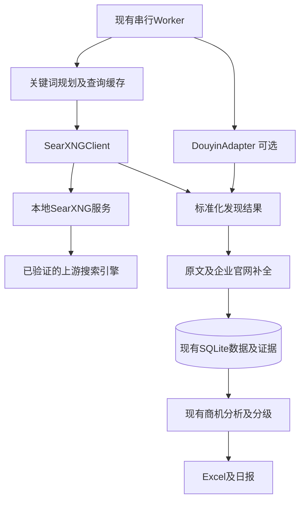

# MVP数据源方案 SearXNG与抖音

版本：1.0  
核对日期：2026年10月23日  
适用架构：Python、FastAPI、SQLite、单个串行Worker  
状态：数据源选型与设计补充，未部署SearXNG，未登录或实测抖音采集

## 1 选型结论

Web搜索优先采用本地部署SearXNG，发现候选企业、企业官网及公开经营内容；随后按允许访问范围抓取原网页，核实业务和联系方式。固定企业名单保留为种子输入，不再要求它是唯一发现入口。

抖音作为第二条可选发现渠道，通过独立适配器接入。cv-cat/DouYin_Spider具备相关搜索及资料读取代码，可用于评估适配工作量；其业务使用授权、登录条件、运行稳定性尚未验证，暂不作为生产必需依赖。

SearXNG加网页抓取足以独立验证MVP闭环；抖音不可用时，任务继续执行Web部分，日报标明实际覆盖。发现渠道最多先做Web和抖音两类；打开搜索结果及企业官网属于证据补全步骤，不等于继续扩展多个平台专用爬虫。

## 2 SearXNG部署与接入

SearXNG作为本机独立搜索服务，业务系统仍是一个FastAPI进程、一个Worker和一个SQLite文件。FastAPI不直接修改SearXNG源码，通过HTTP接口访问，便于独立升级和替换。



建议本机FastAPI使用127.0.0.1:8000，SearXNG通过容器发布到127.0.0.1:8080。部署采用当前官方容器或Compose方案，保留配置和缓存卷；上线固定镜像版本或摘要。容器内部地址和宿主发布地址分开配置，不将8080端口默认暴露给局域网或公网。[官方容器部署](https://docs.searxng.org/admin/installation-docker.html)

本机部署不需要先采购搜索API额度，但仍需要可用网络和上游引擎；机器、带宽、运维以及可能的付费上游不视为天然零成本。SearXNG对上游的可达性、限流和结果覆盖必须在实际网络环境中验证。

### 最小SearXNG配置

以下为私有本机实例的settings.yml建议片段，百度与Bing仅是待验证的首批组合，不表示已经确认可用。

```yaml
use_default_settings:
  engines:
    keep_only:
      - baidu
      - bing

search:
  formats:
    - html
    - json

server:
  public_instance: false
  limiter: false

engines:
  - name: baidu
    disabled: false
  - name: bing
    disabled: false
```

部署时通过SEARXNG_SECRET设置随机密钥。此处limiter:false仅用于端口限制在本机、调用方受控的MVP；业务Worker仍自行限频。若采用官方带Valkey的Compose或以后开放共享实例，应按所选部署模板启用相应限流设施，不能将该片段直接用于公网实例。Valkey如存在，仅服务SearXNG，不是业务任务队列。[配置合并](https://docs.searxng.org/admin/settings/settings.html)、[服务配置](https://docs.searxng.org/admin/settings/settings_server.html)

官方引擎目录包含百度、Bing等候选，但“有适配器”与“在当前网络中能稳定使用”分开验收；可只启用一个可用引擎开始测试。[引擎目录](https://docs.searxng.org/user/configured_engines.html)

### HTTP调用契约

使用GET /search，参数通过HTTPX的params传递，避免手动拼接中文或引号。例如：

```python
params = {
    "q": "珠海 外贸 出口 企业 联系我们",
    "format": "json",
    "categories": "general",
    "pageno": 1,
}
response = client.get("http://127.0.0.1:8080/search", params=params)
```

需要先在search.formats启用json，未启用可能返回403。语言及时间过滤按实例和引擎实际支持设置；site:等语法依赖具体上游，不能把语法未生效当作限定站点检索成功。[Search API](https://docs.searxng.org/dev/search_api.html)

SearXNGClient是允许访问固定本地服务地址的专用客户端；网页Fetcher继续拒绝私网、环回和越界重定向。不能为了接入SearXNG而关闭全局网页抓取的地址校验。API调用者不能覆盖该内部服务地址。

## 3 查询策略与失败处理

先使用少量固定模板，避免第一版增加模型驱动的无限检索循环：

- 发现企业：城市＋外贸、出口、跨境电商、海外客户等业务词。
- 找聚合场景：城市＋多平台、多市场、多币种或境外收支相关经营词。
- 核实企业：已发现企业全名＋官网、国际业务、出口或联系我们。
- 核实账号：企业全名＋抖音、公众号等公开入口；仅返回搜索已收录内容，不声称完整平台覆盖。

建议起始上限为每天20至50个查询、每查询1页、请求串行，间隔及超时按实际引擎表现调整。这些是测试配置，不是上游保证的安全频率或产量。只深度抓取相关且通过URL检查的前若干结果；每企业补全页面数设上限。

保存查询、页码、引擎配置版本、结果URL、摘要、发布时间原值及搜索时间。搜索摘要只作发现，原文缺失时标待研究，不能由摘要直接认定当前支付需求。

HTTP 200不表示所有上游引擎成功。适配器还应检查unresponsive_engines等实例实际返回的错误信息，记录部分失败；响应结构依赖固定版本验证。结果为空且上游失败时，报告“来源受限或失败”，不能简单写“没有商机”。[官方JSON响应实现](https://github.com/searxng/searxng/blob/master/searx/webutils.py)

返回403时先核对JSON配置和本机服务限制；上游429、验证码或访问拒绝时暂停受影响引擎，保留其他可用结果。最多有限重试，不在MVP引入验证码绕过、账号轮换或无限重试。

## 4 统一采集结果与SQLite调整

Web及抖音适配器都输出以下业务层字段，接入现有归一和分析逻辑：

| 字段 | 说明 |
| --- | --- |
| source_type及source_id | WEB_SEARCH或DOUYIN，以及实际提供者或适配器标识 |
| query及discovered_at | 发现查询及时间，不能替代原文发布时间 |
| object_id及url | 网页规范化URL，或平台稳定账号和作品ID及主页或作品链接 |
| title及text | 标题、简介或公开正文，明确是摘要还是原文 |
| published_at | 原文时间，缺失留空 |
| source_metadata | 上游引擎、排序、账号标识、公开认证及来源错误等，不存登录凭据 |
| company_candidates | 企业名称及关联依据，可能为空；账号昵称不直接当法定企业名 |

在原八表基础上可增加一张search_cache：cache_key、query、params_json、provider_version、result_json、engine_errors_json、fetched_at和expires_at。缓存键包含规范化查询、页码、过滤及引擎配置版本；业务关键词保留语义，不随意删掉引号或site:操作符。

成功结果建议缓存24小时，部分失败或失败仅短时缓存或不缓存，避免长期掩盖恢复。每次运行在runs.stats_json记录查询命中缓存情况、来源错误及覆盖；不能将缓存时间写成原网页发布日期。

pages增加metadata_json即可容纳搜索提供者和抖音对象元数据。多家企业仍通过enterprise_pages关联，联系方式及分析结果沿用原表，商机量按企业统计，不按搜索结果、作品或账号数量统计。

## 5 DouYin_Spider核对结果

核对仓库：[cv-cat/DouYin_Spider](https://github.com/cv-cat/DouYin_Spider)。本轮记录的默认分支为master，最近提交为d151f9c2980abc304c1ae4918c2272675cd9e4c2，提交时间2026年10月23日。此处只核对公开文档与代码，未运行采集或验证登录。

| MVP所需能力 | 已核对情况 | 接入判断 |
| --- | --- | --- |
| 关键词找账号 | douyin_api.py包含search_user及search_some_user | 可做候选账号发现；业务含义及稳定性需实测 |
| 关键词找作品 | 包含综合及视频搜索接口，main.py包含搜索采集入口 | 可提取公开作品文字信号；首版不下载媒体或做转写 |
| 用户资料与作品 | 包含get_user_info及作品详情等接口 | 有助于核实账号、业务与公开商务入口 |
| 珠海及周边筛选 | 已核对接口不能据此保证企业注册地或办公地 | 关键词命中后仍由主体及地址证据核实 |
| 负责人电话或邮箱 | 不能由上述能力承诺获得直联方式 | 仅提取公开商务文案、主页入口或官网联系方式 |
| 登录与运行依赖 | README要求有效登录Cookie；依赖列表含较多网络及媒体组件 | 需要受控登录会话及独立依赖评估，不默认无账号可运行 |

代码依据：[接口封装](https://github.com/cv-cat/DouYin_Spider/blob/d151f9c2980abc304c1ae4918c2272675cd9e4c2/dy_apis/douyin_api.py)、[入口](https://github.com/cv-cat/DouYin_Spider/blob/d151f9c2980abc304c1ae4918c2272675cd9e4c2/main.py)、[依赖](https://github.com/cv-cat/DouYin_Spider/blob/d151f9c2980abc304c1ae4918c2272675cd9e4c2/requirements.txt)。

商业使用依赖尚未解决：当前完整文件树未发现LICENSE文件，GitHub仓库元信息的license为null，README写有仅供学习与技术研究使用。因此不能把“公开仓库”直接视为已获得本项目所需使用授权；确认适用授权后再决定是否复用其代码，或选择授权明确的实现。仓库代码许可与平台数据访问条件还需分别确认。[仓库说明](https://github.com/cv-cat/DouYin_Spider/blob/master/README.md)、[GitHub许可证说明](https://docs.github.com/en/repositories/managing-your-repositorys-settings-and-features/customizing-your-repository/licensing-a-repository)

## 6 抖音适配器最小设计

独立封装DouyinAdapter，只暴露search_profiles、search_posts、fetch_profile和fetch_post四类只读业务能力。主流程不直接导入仓库示例main.py；适配器统一将返回值转成第4章结构，并限制分页、作品数量、超时及结果体积。

仅纳入企业或公开商务场景所需的昵称、简介、主页及作品链接、公开认证标识、内容文案和来源时间。账号先作为候选对象，缺少企业归属依据时不创建已核实企业；不以昵称相同、粉丝数量或关注关系推定企业身份。

私信、发布、点赞、收藏、直播互动、粉丝和关注关系批量采集均不进入本MVP。会话信息放受控凭据配置，不能写入SQLite业务表、模型提示、普通日志或Excel。遇登录失效、验证码或权限限制，来源转为待人工处理，不能自动绕过验证。

若采用该仓库，固定提交及依赖；考虑其依赖面，优先在独立虚拟环境或本机子进程内运行只读适配，向Worker返回限定大小的标准JSON。子进程限时、禁止继承无关密钥，不传任意shell命令。该隔离方式用于减少依赖冲突，是否需要额外常驻服务由实测决定，首版不默认新增微服务。

## 7 接入顺序与验收

| 步骤 | 工作 | 最小验收 |
| --- | --- | --- |
| 1 | 本地SearXNG及JSON接口 | 明确镜像版本；本机接口返回JSON，端口未对外开放，配置及持久化可恢复 |
| 2 | 中文引擎验证 | 使用一组珠海企业相关查询，分别记录每引擎成功率、空结果及错误，至少一个有效引擎可用 |
| 3 | Web发现及原文补全 | 查询缓存、结果排重、源网页读取及官网关联真实有效；摘要不冒充原文 |
| 4 | 现有MVP闭环 | 企业、证据、联系入口、分析及Excel日报跑通；至少一条真实合格A或B结果，弱候选留C |
| 5 | 抖音条件验证 | 明确代码使用依据，具备适当访问条件；少量关键词、账号和作品能稳定返回并保留归属证据 |
| 6 | 异常及覆盖报告 | SearXNG上游部分失败、抖音待登录或停用时仍能输出Web结果和真实覆盖，故障不伪装成零商机 |

首版建议先交付SearXNG闭环，再将抖音接入作为独立增量。若选择的抖音实现未满足条件，保留适配器接口及不可用状态，不能宣称已经接入。每周100个以上仍通过真实供给及销售反馈验证，不因增加搜索入口而自动保证。

## 8 对既有文档的影响

本方案将技术文档中的“固定目录发现爬虫”扩展为“可替换发现适配器，默认评估SearXNG”，官网及原文抓取继续保留。抖音从完全延后调整为可选、待验证的第二渠道；来源未启用不计入实际覆盖。

FastAPI最小接口、SQLite任务、单Worker、分析分级、500元月预算和Excel日报规范保持适用。新增search_cache及pages.metadata_json、SearXNG本机服务和来源健康统计；不增加公网搜索接口、MCP或自动触达能力。本次只形成设计补充，未安装依赖、开通账户、执行登录或实际部署。
